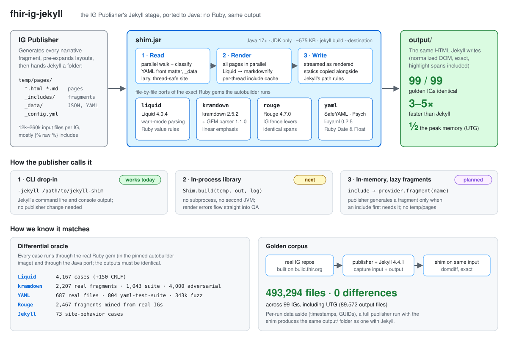

# fhir-ig-jekyll

**A Java replacement for the Jekyll (Ruby) stage of the [FHIR IG Publisher](https://github.com/HL7/fhir-ig-publisher):
no Ruby, same output, 3–5× faster, about half the memory.**

**Get started** (Java 17+; Windows: use [`jekyll-shim.cmd`](https://github.com/jmandel/fhir-ig-jekyll/releases/latest/download/jekyll-shim.cmd)):

```sh
curl -fLO https://github.com/jmandel/fhir-ig-jekyll/releases/latest/download/jekyll-shim && chmod +x jekyll-shim
java -jar publisher.jar -ig . -jekyll "$PWD/jekyll-shim"    # first run fetches and verifies shim.jar, then works offline
```



## Why

To render an IG's narrative pages, the publisher writes `temp/pages` and runs `jekyll build`. That puts
a whole second toolchain (Ruby 3.2, Jekyll 4.4.1, Liquid, kramdown, Rouge, libyaml) into every place an
IG is built: the autobuilder, CI images, and every author's laptop. It has its own install pains,
especially on Windows, and its own security patch cycle, and it is the slow, memory-hungry part of the
pipeline that nobody on the Java side can debug.

The publisher uses only a small, stable slice of Jekyll. Layouts are pre-expanded, front matter is
empty, and most of the input is `` fragments. So this project doesn't try to be "a Jekyll in
Java". It is a **faithful, file-by-file port of the slice real IGs use**, checked against the real gems
until the output is identical.

## Results

### Output: identical

The bar is **exact equality with real Jekyll** after DOM normalization (attribute order, insignificant
whitespace, entity spelling). Syntax-highlight `<span>`s are compared too, because the templates style
them.

| Check | Result |
|---|---|
| Golden corpus: real publisher + real Jekyll on real IGs from build.fhir.org, then the shim on the same input | **266 IGs (the IGs built on build.fhir.org over a month): 260 identical, 1,024,171 files**, including UTG (259k input → 89,572 output files). The other 6 can't be identical by construction: 3 differ only in build timestamps (`site.time`), 2 include files under a name that differs only in case (the goldens were recorded on a case-insensitive disk), and in 1 real Jekyll itself fails |
| Full publisher run (`-jekyll jekyll-shim`) vs a real-Jekyll publisher run (UDAP) | identical apart from per-run data (build timestamps, GUIDs, QA timing counters) |
| Liquid 4.0.4: differential vs the real gem | 4,167 / 4,167 cases (+150 CRLF variants) |
| kramdown 2.5.2 + GFM | 2,207 / 2,207 real IG fragments · 4,000 / 4,000 adversarial emphasis cases · upstream suite 702 / 1,043 exact, the other 341 being code fences in languages no IG uses, whose Rouge lexers aren't ported (they render as plain text) |
| YAML (SafeYAML → Psych → libyaml) | 687 real IG files · 804 yaml-test-suite cases · 343k fuzz, typed values identical |
| Rouge 4.7.0 | 2,467 / 2,467 highlighted fragments mined from real IGs |
| Jekyll site behavior | 75 / 75 cases (filters, includes, `site.*`, static-file paths, collisions) |
| Template/IG surface inventory | 79 / 79 features observed in sampled IGs covered |

### Speed: 3–5× faster on the Jekyll stage

Same machine (Lima VM, 16 vCPU), same load, same input, both writing to local disk:

| IG | Input → output files | Jekyll 4.4.1 | Shim | Speed-up |
|---|---:|---:|---:|---:|
| IHE ITI.MHD | 12k → 2.1k | 10.6 s | 3.5 s | 3.0× |
| US Core | 35.5k → 16.6k | 75.6 s | 21.7 s | 3.5× |
| UTG | 259k → 89.6k | 197.6 s | 65.9 s | 3.0× |
| fhir-extensions | 179k → 29.8k | 571.7 s | 106.0 s | 5.4× |

Most of the shim's remaining time is **reading the input folder**: 65 s of UTG's run and 86 s of
fhir-extensions' are file reads over the VM's shared filesystem, while rendering is 12–23 s. In-process
integration (below) removes that round trip entirely.

### Memory: about half

UTG, the largest IG, measured the same way for both (`scripts/peakmem.sh`, peak RSS of the whole process
tree):

| | Peak RSS | Wall time |
|---|---:|---:|
| Jekyll 4.4.1 (Ruby) | 4,080 MB | 197.6 s |
| Shim (heap capped at 1.5 GB for the measurement) | 1,952 MB | 65.9 s |

The shim's **live heap peaks at about 0.7 GB** on UTG. With no cap, the JVM grows its heap lazily
when memory is free (6.1 GB RSS on a 94 GB VM), but it does not need that much. The wrapper therefore
sets no `-Xmx` or `-Xss`, only `-XX:MaxRAMPercentage=75`, so big IGs don't need tuning flags.

### How much of a full build is Jekyll?

Jekyll is usually a small part of a publisher run: **2–5%** on the 8 IGs timed in detail (US Core:
37.6 s of 787 s). UTG is the outlier, with Jekyll taking roughly 5–13% of a 63-minute build depending on
machine load. Shaving those minutes is nice, but the main wins are removing the Ruby toolchain, and what
in-process integration enables next: no temp/pages round trip, and fragments generated only when used.

### The "long lines are slow" problem: fixed, same output

Some pages took Jekyll orders of magnitude longer than their size suggests. The cause is kramdown's
emphasis parser backtracking on long paragraphs with many unmatched `_` or `*`, which grows faster than
quadratically. The classic trigger is an unfenced JSON example with `"_birthDate"`-style keys: an 80-entry FHIR Bundle pasted
without a code fence takes Jekyll 13–15 s, against 0.013 s fenced. Rouge's
Java lexer has a similar quadratic rule. The port replaces those paths with proven-equivalent linear
checks (verified over millions of positions, with output unchanged):

| Input | Ruby | Shim |
|---|---:|---:|
| `"_b "` × 1000 (3 KB paragraph) | 6.9–10 s | 0.008 s |
| `"_word "` × 1000 | > 20 s | 0.005 s |
| `"*a* _b* "` × 5000 | > 20 s | 0.029 s |
| Pathological 100 KB ```` ```java ```` block | 17.2 s | 0.013 s |

On the real corpus, Jekyll's markdown throughput was flat (about 3.5 MB/s) and no IG hit the cliff
badly, but hand-authored pages can.

### Portability

Plain JDK 17+ with no native code. File paths, CRLF input and Windows line endings follow Ruby's
semantics, and number and date formatting is locale-independent (verified under Arabic, Turkish and
Thai default locales). Wrappers are provided for Unix (`jekyll-shim`) and Windows (`jekyll-shim.cmd`). CI runs
the test suites, an end-to-end site and the wrapper bootstrap on Linux, macOS and Windows; the golden
corpus runs on Linux.

## What it supports, and what it doesn't

Supported: everything the sampled IGs use, including:
- Liquid 4.0.4 in Jekyll's warn mode (strict parse with lax fallback, the same warnings), with all
  standard tags and filters
- Jekyll's `include` / `include_relative` / `highlight` tags and its filters (`markdownify`, `jsonify`,
  `where`, `where_exp`, `group_by`, `sort`, `date_to_*`, and more)
- `site.pages`, `site.data` (JSON / YAML / CSV / TSV) and `site.static_files`
- kramdown with GFM, TOC, auto ids, smart quotes and footnotes; Rouge highlighting for every fence
  language IGs use
- the `liquid:` and `kramdown:` options in `_config.yml`

Not implemented: Jekyll features the publisher pipeline doesn't use, such as Ruby plugins, themes and
Sass, `jekyll serve` / watch mode, and other site features no sampled IG uses. Behavior on unusual input,
such as unknown filters being ignored or warn-mode fallbacks, follows Jekyll's.

## Use it

Needs Java 17+, which the IG Publisher already requires. Like the Gradle wrapper, one small file is all
you need: it pins a release, downloads that release's `shim.jar` on first use, checks its SHA-256, caches
it in `~/.fhir-ig-jekyll/<version>/`, and runs offline from then on.

```sh
# Linux / macOS
curl -fLO https://github.com/jmandel/fhir-ig-jekyll/releases/latest/download/jekyll-shim && chmod +x jekyll-shim
java -jar publisher.jar -ig . -jekyll "$PWD/jekyll-shim"
```

On Windows, download
[`jekyll-shim.cmd`](https://github.com/jmandel/fhir-ig-jekyll/releases/latest/download/jekyll-shim.cmd)
and pass its full path: `-jekyll C:\path\to\jekyll-shim.cmd`. You can commit the wrapper into an IG
repository (like `gradlew`) or put it on your `PATH`. To move to a newer version, download the newer wrapper.

- Offline or air-gapped:
  [`fhir-ig-jekyll.zip`](https://github.com/jmandel/fhir-ig-jekyll/releases/latest/download/fhir-ig-jekyll.zip)
  bundles `shim.jar` with both wrappers, which use the jar next to them. Alternatively, set
  `FHIR_IG_JEKYLL_JAR=/path/to/shim.jar`.
- Mirrors: `FHIR_IG_JEKYLL_URL` overrides the download URL; `FHIR_IG_JEKYLL_HOME` moves the cache.
- Just the jar:
  [`shim.jar`](https://github.com/jmandel/fhir-ig-jekyll/releases/latest/download/shim.jar), run in a
  Jekyll source folder: `java -jar shim.jar build --destination ../output`.

From source: `shim/build.sh` builds `shim/build/shim.jar`. It uses your JDK, or the reference Docker image
if there is no `javac`.

Knobs (all optional): `SHIM_RENDER_THREADS`, `SHIM_IO_THREADS`, `SHIM_TIMING=1`.

## Integration roadmap

1. **CLI drop-in:** works today with an unmodified publisher (`-jekyll <cmd>`).
2. **In-process library:** the API is in the shim today: `org.hl7.fhir.jekyll.Shim.build(source,
   destination, options)`, called from the publisher's `runJekyll`. No subprocess or second JVM, and
   errors arrive as exceptions for QA. A publisher-side prototype is in progress.
3. **Lazy fragments:** `Shim.Options.includeProvider(...)` lets the publisher supply `_includes` content
   on demand, so it can generate each narrative fragment only when a page first includes it. 75–86% of
   `_includes` files are never included (UTG: 134k of 166k, 1.25 of 2.06 GB), so this skips most of the
   fragment generation and `temp/pages` writing. Also being prototyped on the publisher side.

Details: [`shim/INTEGRATION.md`](shim/INTEGRATION.md).

## Repository layout

| Path | What |
|---|---|
| `shim/` | Java sources (`org.hl7.fhir.jekyll.{liquid,kramdown,rouge,yaml,site,util}`), tests, the differential oracle, porting notes (`NOTES-*.md`), integration notes |
| `scripts/` | corpus sampling, golden builds, the `domdiff.py` comparator, timing / memory / locale tools |
| `docker/` | the reference image: the autobuilder's localdev image pinned by digest, plus optional extra CAs |
| `lima/` | Lima VM definition for large corpus runs |
| `docs/TRACKER.md` | the live project tracker: plan, decisions, evidence and open items |
| `tracker-app/` | a small dashboard for the tracker |
| `third_party/` | the upstream Ruby sources as optional shallow submodules ([details](third_party/README.md)) |

## Developing

Building and testing need only a JDK:

```sh
scripts/test-suites.sh     # differential suites vs recorded Ruby output (~19.5k cases)
scripts/e2e.sh             # a fixture site through the wrapper vs real Jekyll's output
```

CI runs both, plus `scripts/test-wrapper.sh` (wrapper download, verify, cache), on Linux, macOS and
Windows, with JDK 17 and 21. A few cases have documented, expected
differences, listed with their reason in `shim/tests/**/<cases>.jsonl.known`: lexers no IG uses, UTC
offsets beyond ±18:00, and clock-dependent cases. Those are reported as `known`, and any other
difference fails the run.

The upstream sources in `third_party/` are for reading the Ruby beside the Java and for regenerating
some test cases:

```sh
git submodule update --init --depth 1     # optional, ~26 MB
```

The oracle (`shim/oracle/oracle.sh`) runs the *real* gems inside the pinned image, and every module has
a case runner (`DiffRunner`) that compares against those outputs. [`shim/README.md`](shim/README.md)
describes the module contracts. Golden-corpus runs use `scripts/golden-build.sh`, `scripts/corpus-run.sh`
and `scripts/shim-all.sh`.

## License

BSD 3-Clause, see [`LICENSE`](LICENSE). The ported projects' notices (MIT; BSD-2-Clause for Ruby,
date and the Pygments-derived lexers; Apache-2.0 for one Addressable function) are in
[`THIRD_PARTY_NOTICES.md`](THIRD_PARTY_NOTICES.md).
